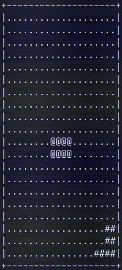
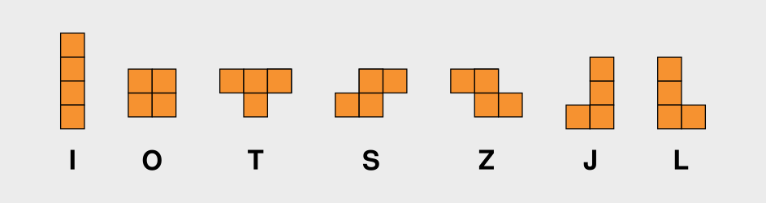
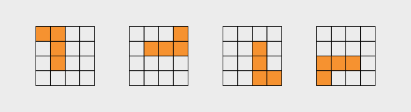
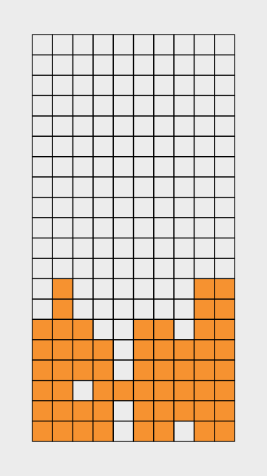
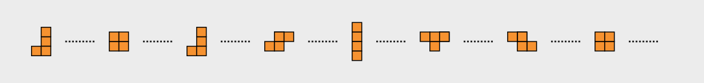
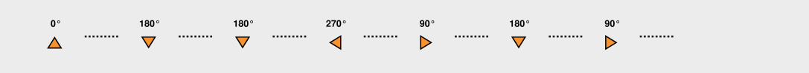
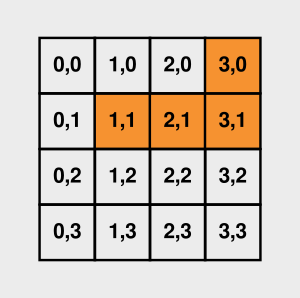

# A tetroid game in Coal

## About this tutorial

At first glance, Coal’s restrictions may seem to make it next to impossible to write any useful programs at all. 
The goal of this tutorial is therefore to show how to do more interesting things than just compute factorials. 
Here we will develop a minimal Tetris-like game in Coal.
Through this concrete example, we will demonstrate how Coal’s programming model can be applied to something practical. (And what could be more practical than Tetris?)
We will deal with several concepts found in “real” programs, including state management, user input, event handling, and interaction with the outside world (I/O). There are a few ideas that lead us to approach these concepts differently from how we would develop the game in other programming languages:

- **Declarativeness**: Coal requires programs to be written in a declarative way: we describe what each part of the game **is**, rather than giving a sequence of instructions describing what the program **does**.
- **Purity**: The code is mostly pure, with two exceptions: I/O is necessary to render the game in the terminal and to acquire a random seed from the underlying C runtime. The seed ensures that the sequence of pieces is different for each game.
- **Totality**: Since every function must terminate and return a value for all possible inputs, infinite loops cannot be expressed in a trivial way in Coal. Instead, computations that continue indefinitely are modeled using *corecursion* and streams. This leads to the distinction between data and *codata*.

The tutorial assumes that you are already somewhat familiar with the basic idea of [Tetris](https://en.wikipedia.org/wiki/Tetris); if not, you may want to research the game before continuing. Please note that we will try to follow the rules and terminology of the original game as closely as practically possible, but don't expect a genuine clone of any particular version of the game.

In this first crude version, a small C runtime will be used to draw the game in the terminal. A future version could replace the terminal interface with a more polished desktop or browser-based UI.

<div style="background: #1e212fff; width: 100%; text-align: center;"></div>

The source code of the game and this document are available [here](https://codeberg.org/laserpants/coal-examples/src/branch/main/game).

## Parts

Before we go ahead and create the actual game loop and the code that responds to user input and other events, let's look at the different building blocks that make up the game — the tetromino shapes, their rotations, the falling piece, the board, and the game state that ties it all together.
In this section we will work out how to represent each of these in code. It makes sense to keep these representations as simple as possible, since every other part of the program will be written in terms of them.

> ##### Numeric types
> 
> Coal has several numeric types. In this example, we'll mostly use `int32` and `nat` to represent numeric values.
> 
> - `int32` is Coal's fixed-width 32-bit integer type. In the game, it is used for coordinates and for values passed to or received from C functions.
> - `nat` is the type of natural numbers, used for sizes and indices (`List.length`, `range`, `remove_source`). See [Natural numbers](https://coal-lang.org/language-manual/#natural-numbers_1) in the language manual for a more detailed explanation.
> - Some functions convert between these two using `Nat.to_nat` and `Nat.pack`.

### Tetrominoes

The central element of the game is the *tetromino*. A tetromino is a geometric shape made up of four equally-sized squares connected edge-to-edge. There are seven distinct tetrominoes, conventionally named I, O, T, S, Z, J, and L.



In code, we will represent a tetromino using the following data type:

```coal
type Tetromino
  = ShapeI
  | ShapeO
  | ShapeT
  | ShapeS
  | ShapeZ
  | ShapeJ
  | ShapeL
```

> ##### Explainer
> 
> The `type` keyword in Coal introduces a new algebraic data type. Algebraic data types can be constructed in two ways: using products and sums. A *sum* is a choice between alternatives: a value belongs to exactly one of the specified constructors.
> See the [Data types](https://coal-lang.org/language-manual/#data-types) section of the language manual for a more detailed explanation.

### Orientations

A tetromino can have one of four rotation states, or *orientations*: 0°, 90°, 180°, or 270°. Here is what the L tetromino looks like in each of these states:



Orientation is also straightforward to represent as a sum-type:

```coal
type Orientation
  = R0
  | R90
  | R180
  | R270
```

Some tetrominoes have rotational symmetry. For example, rotating the O doesn't change its shape. In the game, however, we still represent the four states explicitly, since the orientation of a piece determines which cells of the board it occupies.

We need a function to change the orientation stepwise when the *up* key is pressed:

```coal
fun rotate
  | R0   => R90  
  | R90  => R180 
  | R180 => R270 
  | R270 => R0   
```

> ##### Explainer
> 
> This syntax defines a top-level function using a list of patterns and the corresponding expressions, without explicitly naming the function argument. It is equivalent to a `match` expression:
> 
> ```coal
> fun rotate(orientation : Orientation) =
>   match(orientation) {
>     | R0   => R90  
>     | R90  => R180 
>     | R180 => R270 
>     | R270 => R0   
>   }
> ```
> 

### Pieces

A *piece* represents a tetromino located at a given position and in a particular orientation on the board. 
It is convenient to represent it using a record, since it has multiple properties:

```coal
type alias Piece =
  { tetromino : Tetromino
  , orientation : Orientation
  , pos_x : int32
  , pos_y : int32
  }
```

> ##### Explainer
> 
> A *record* in Coal is formed by a sequence of comma-separated fields enclosed in curly braces. Each field has a name, called its *label*, and a value:
> 
> ```coal
> { shape = "octagon"
> , edges = 8
> }
> ```
> 
> The type of a record is described using a similar syntax, but specifies a type for each field instead of a value:
> 
> ```coal
> { shape : string
> , edges : int32
> }
> ```
> 
> We also give this type a name using a *type alias*. This makes it possible to refer to it simply as `Piece` instead of repeating the whole thing. 
> See the language manual for a more detailed overview of [records](https://coal-lang.org/language-manual/#records), and [type aliases](https://coal-lang.org/language-manual/#type-aliases).

#### Active piece

There is one special piece in the game, namely the one that is currently controlled by the player. We refer to this as the *active* piece.
The following default piece is used as a template when updating the active piece:

```coal
let default_piece : Piece = 
  { tetromino = ShapeI
  , orientation = R0
  , pos_x = 3
  , pos_y = 0
  }
```

Since the `Tetromino` type on its own doesn't contain any information about the geometry of the tetromino it represents, we need a mapping from pieces to the cells they occupy. We define that mapping in [Tetromino cells](#tetromino-cells).

### The board

The *board* is where the game takes place. It is a 10 × 20 grid, whose elements we will refer to as *cells*. Each cell is either empty or occupied.



In the code, we keep this as simple as possible. We represent a cell as a pair `(int32, int32)` holding its `x` and `y` coordinates. The board is then simply a set of cells — those that are currently occupied:

```coal
type alias Board = Set<(int32, int32)>
```

The active piece is not part of the `Board`; it is merged into the board when it lands.

When the game starts, the board is empty:

```coal
let empty_board : Board =
  Containers.Set.empty
```

> ##### Explainer
> 
> `Set` is an immutable balanced tree, part of the [`coal-containers`](https://codeberg.org/laserpants/coal-containers) package. Note that the `Set` module is imported qualified:
>
> ```coal
> import namespace Containers.Set
> ```
>
> That is why we need to write `Containers.Set.empty` here, as opposed to just `empty`.

### GameState

The *game state* is a record containing everything the game needs to keep track of while it is running. This is:

  - The `Board`.
  - The currently active `Piece`.
  - A `Stream<Piece>` that supplies the pieces the game draws from.
    
```coal
type alias GameState =
  { board : Board
  , active_piece : Piece
  , piece_supply : Stream<Piece>
  }
```

> ##### Explainer
>
> A `Stream<a>` is *codata*: unlike a list, which is finite, a stream is a potentially infinite sequence produced lazily, one element at a time. You consume it with `head` (the next element) and `tail` (the rest), both from `Codata.Stream`; `repeat(x)` yields `x` forever. This is how the game models an endless supply of pieces without writing an infinite loop.

We also define a default game state to use as a starting point:

```coal
let default_game_state =
  { board = empty_board
  , active_piece = default_piece
  , piece_supply = repeat(default_piece)
  }
```

Here `repeat(default_piece)` is a placeholder supply that yields the same piece forever. It is replaced with a real, randomly generated supply when the game starts, in `main`.

Next, let's see how the `piece_supply` field of the game state is built. It is the one part of the state that is generated rather than derived from the player's actions.

### Piece supply

When a falling piece reaches the bottom of the board or lands on another block, it locks into place. A new piece then spawns at the top of the board.
To keep generating new pieces throughout the game, we need two random streams:

- One for the tetrominoes:

    

- And one for the orientations:

    

For these, we are going to use the [`coal-random`](https://codeberg.org/laserpants/coal-random) package and the `pick` function, which returns a stream of random elements drawn from a non-empty list of elements.

- `Stream<Tetromino>`:

    ```coal
    pick(seed, Cons(ShapeI, [ShapeO, ShapeT, ShapeS, ShapeZ, ShapeJ, ShapeL])),
    ```

- `Stream<Orientation>`:

    ```coal
    pick(seed, Cons(R0, [R90, R180, R270]))
    ```

> ##### Explainer
>
> The `NonEmptyList` data type used here is part of the [`coal-containers`](https://codeberg.org/laserpants/coal-containers) package. 
> A stream cannot be empty, so to generate one from a list, that list needs to have at least *one* element. 
> Under the hood, a `NonEmptyList` is just an ordinary list coupled with an extra element:
>
> ```coal
> type NonEmptyList<a> = Cons(a, List<a>)
> ```

The first argument to `pick` is an opaque *seed* responsible for initializing the pseudorandom number generator.
Since `pick` is a pure function, the same seed always produces the same sequence of numbers.
To make each game unique we can generate a fresh seed derived from the system clock.
That way the player experiences some actual randomness.

```coal
random_seed : unit -> IO<Seed> 
```

The function `map2_stream` takes a `Stream<a>` and a `Stream<b>` and fuses them into a `Stream<c>`.
Its first argument is a function `a -> b -> c` that describes how each `a, b` element-pair is combined. 
`map2_stream` is exactly what we need in order to combine tetrominoes and orientations into a `Stream<Piece>`:

```coal
fun piece_supply(seed) =
  map2_stream(
    fn(tetromino, orientation) => 
      default_piece{ tetromino = tetromino, orientation = orientation }, 
    pick(seed, Cons(ShapeI, [ShapeO, ShapeT, ShapeS, ShapeZ, ShapeJ, ShapeL])),
    pick(seed, Cons(R0, [R90, R180, R270]))
  )
```

> ##### Explainer
> 
> The expression `default_piece{ tetromino = tetromino, orientation = orientation }` is a partial update that 
> makes a copy of the `default_piece` record, replacing only the `tetromino` and `orientation` fields.

> ##### Note
>
> Both `pick` calls receive the same `seed`. Because `pick` is deterministic, the two streams are derived from the same pseudorandom sequence, so the tetromino and orientation streams are not fully independent. If that matters, derive a second seed for one of them.

## Mechanics

### Updating the board

Many of the functions used to update the game operate on `GameState` values.
They all take a `GameState`, sometimes together with other arguments, and return a new `GameState` reflecting the action we want to perform. 
Most of these updates involve changing the `Board`.
When a piece lands, for example, we need to add its cells to the board. 
We may also need to clear one or more completed rows and shift the rows above the cleared rows down.
To get an idea of how this works, here is the function that removes one specific row from the board:

```coal
fun board_remove_row(y : int32, board : Board) =
  List.reduce_left(
    fn(acc, x) => Containers.Set.delete((x, y), acc),
    board,
    range(0, 10)
  )
```

We also need functions to check which cells are occupied and to query the board in other ways.
The board API defines these along with the functions for updating the board (including `board_remove_row`, which we have already seen in full). 
To keep things short, we'll show only the *types* of these functions, leaving out their implementations. 
Take a look at the source code if you're interested in the details.

> ##### Reminder
> 
> A function with multiple arguments, like `f(x : int32, y : int32) : bool`, is *curried*, so its type is written with arrows: `int32 -> int32 -> bool`. 
> A function that takes a single pair treats that pair as one type, as in `(int32, Board) -> Board`.

#### Looking up and adding cells

These functions work with individual cells. 
Pretty much everything else is built on top of them:

```coal
fun is_board_member(cell : (int32, int32), board : Board) : bool
fun board_insert(cell : (int32, int32), board : Board) : Board
fun board_insert_cells(cells : List<(int32, int32)>, board : Board) : Board
fun board_cell_is_set(cell : (int32, int32), game_state : GameState) : bool
```

- `is_board_member` has type `(int32, int32) -> Board -> bool`. It takes a cell (a pair of coordinates) and the board, and returns whether the cell is currently occupied.
- `board_insert` has type `(int32, int32) -> Board -> Board`. It takes a cell and the current board, and returns a board with the cell added.
- `board_insert_cells` has type `List<(int32, int32)> -> Board -> Board`. It adds all cells in the list to the board. This is useful when a piece locks into place, since it occupies four cells.
- `board_cell_is_set` has type `(int32, int32) -> GameState -> bool`. It checks whether a cell is occupied in the board contained in a `GameState`. This is a convenience for collision-checking functions, which can pass the `GameState` directly instead of first extracting `state.board`.

Recall that a cell is just a pair `(int32, int32)` and that the `Board` is a `Set` of those pairs. 
So `is_board_member` and `board_insert` are really just thin wrappers around the matching `Set` operations.

#### Counting, removing, and shifting rows

Clearing a completed line means inspecting and rearranging whole rows, so we need a few row helpers. A row is identified by its `y`-coordinate, and the columns run from 0 to 9. (Note that `range(0, 10)` is how we write those ten columns: the second argument to `range` is a *count*, not an upper bound, so `range(0, 10)` is the list `[0, 1, …, 9]`.)

```coal
fun board_count_in_row(y : int32, board : Board) : int32
fun board_shift_row(y : int32, board : Board) : Board
fun board_shift_rows_above(cleared_y : int32, board : Board) : Board
```

- `board_count_in_row` has type `int32 -> Board -> int32`. It counts how many cells are filled in row `y` — somewhere between 0 and 10. Once that count hits 10, the row is full and should be cleared.
- `board_shift_row` has type `int32 -> Board -> Board`. It moves every filled cell in row `y` down one, into row `y + 1`, which closes that gap.
- `board_shift_rows_above` has type `int32 -> Board -> Board`. It shifts every row above `cleared_y` down by one, so the whole stack resting on the cleared line falls into place.

> ##### Note
>
> This works only because `reduce_left` folds the list **right-to-left**: the range `[0, …, cleared_y - 1]` is therefore consumed from `cleared_y - 1` down to `0`. Processing the rows in the other direction would shift the same cells repeatedly and collapse the stack.

#### Clearing completed lines

The row helpers come together in a small clearing algorithm:

```coal
fun board_clear_step(pair : (int32, Board)) : (int32, Board)
fun board_clear_full_rows(board : Board) : Board
```

- `board_clear_step` has type `(int32, Board) -> (int32, Board)`. It does *one* step of the scan. You hand it a row index `y` paired with a board, and it either finds row `y` full — in which case it removes that row and shifts the rows above it down — or, if the row isn't full, just moves on to `y - 1`. It carries the board and the row index around together, because that pair is all the state the scan needs from one step to the next.
- `board_clear_full_rows` has type `Board -> Board`. It runs `board_clear_step` over and over, starting at the bottom row (index 19) and working its way up, until it has checked the whole board, then gives you back the result.

> ##### Explainer
> 
> ```coal
> let (_, result_board) =
>   iterate(50, board_clear_step, (19, board)) 
> in 
>   result_board
> ```
> 
> Since Coal has no general recursion, repetition is achieved here using the `iterate` combinator from `Coal.Combinators`, which applies a function a fixed number of times. 
> We just pick a bound that is big enough to cover every row of the board.
>
> The bound is 50 rather than 20 because a row that gets cleared stays at the same index (so it can be re-examined) and the scan also needs one step per row to walk to the top. The bound for `drop_to_bottom` (30) only has to exceed the board height of 20.

#### Translating the board

Last but not least, we need a way to turn the board into a plain list, since that is what the renderer expects:

```coal
fun board_to_list(board : Board) : List<(int32, int32)> =
  Containers.Set.to_list(board)
```

### Cells

Cells are like the atoms in the universe of this game. They are also commonly referred to as *blocks* or *minos* in Tetris terminology.
The functions here operate at the cell level to manipulate or peek at the cells of a piece.
These will be essential later for collision checks, which determine whether the active piece would overlap with anything on the board, and for rendering, which needs to know which cells to draw.

#### Tetromino cells

As previously mentioned, the `Tetromino` type on its own doesn't say anything about the actual geometry of the shape it represents. It is just an identity.
To move and land the currently active piece, the game needs a way to figure out the cells it occupies from its shape, orientation, and position.
The function `tetromino_cells` does most of this for us — it takes a `Tetromino` and an `Orientation` and returns a `Set<(int32, int32)>` of cells.
For example, for `ShapeL` and `R90` it contains the following cells (shown as a list for readability; a `Set` itself is unordered):

```text
[ (3, 0), (1, 1), (2, 1), (3, 1) ]
```



> ##### Explainer
>
> In the source, `tetromino_cells` is written as `Containers.Set.from_list .| match(tetromino) { … }`. `.|` is the *forward application* operator, the mirror image of the `|.` used later: `x .| f` means `f(x)`, which lets a value head a pipeline of transformations.

#### Shifting cells

To get the actual cells the piece occupies on the board, we then offset these coordinates by its `x` and `y` position.

```coal
fun translate_cell(d_x : int32, d_y : int32, (cell_x, cell_y) : (int32, int32)) : (int32, int32)
fun translate_cells(d_x : int32, d_y : int32, cells : List<(int32, int32)>) : List<(int32, int32)>
```

These functions handle the coordinate arithmetic.

- `translate_cell` has type `int32 -> int32 -> (int32, int32) -> (int32, int32)`. It takes a horizontal step `d_x`, a vertical step `d_y`, and a cell, and returns the cell shifted by that amount: `(cell_x + d_x, cell_y + d_y)`.
- `translate_cells` has type `int32 -> int32 -> List<(int32, int32)> -> List<(int32, int32)>`. This function performs the same translation on all cells in the given list.

> ##### Explainer
> 
> ```coal
> fun translate_cells(d_x : int32, d_y : int32, cells : List<(int32, int32)>) =
>   List.map(translate_cell(d_x, d_y), cells)
> ```
>
> The expression `translate_cell(d_x, d_y)` is a partially applied function. It produces a function that takes a cell and translates it, which is exactly what `List.map` expects.

#### Turning a piece into cells

The last function brings the two together:

```coal
fun active_piece_cells(game_state : GameState) : List<(int32, int32)>
```

- `active_piece_cells` has type `GameState -> List<(int32, int32)>`. It pulls the active piece out of the game state, looks up the cells of its shape with `tetromino_cells`, and shifts each one by the piece's position. The result is the list of board coordinates the piece currently covers. Since the shape comes back as a `Set`, it's first converted to a list so that the renderer and the collision checks can walk over it.

### Collisions

Collision detection is the process of determining whether two objects overlap or occupy the same space.
We need this to determine whether a piece can move or rotate without overlapping existing blocks or moving outside the playfield.
The following functions inspect the game state to perform these collision checks and return a `bool`.

```coal
fun cell_collides((x, y) : (int32, int32), game_state : GameState) : bool
fun cells_collide(cells : List<(int32, int32)>, game_state : GameState) : bool
```

- `cell_collides` has type `(int32, int32) -> GameState -> bool`. It takes a cell and a game state, and returns whether the cell is an invalid position — either because it lies outside the playfield or because it is already occupied by a block.
- `cells_collide` has type `List<(int32, int32)> -> GameState -> bool`. It checks a list of cells and returns `true` if any of them collides, using `List.any` with `cell_collides`. This is the function used by the movement code, since a piece occupies four cells.

> ##### Explainer
>
> `cells_collide` is `List.any` over the piece's cells, `translate_cells` is `List.map`, and `board_remove_row` is a `reduce_left`. Much of what looks like an algorithm here is a single library combinator applied to a list.

The bounds test spells out the playfield we described earlier: a cell's x-coordinate runs from 0 to 9 and its y-coordinate from 0 to 19, so `x < 0`, `x >= 10`, and `y >= 20` all count as collisions. There's no `y < 0` check, though — the top edge isn't a wall, so a piece is free to poke out above the board.

### Movements

The next thing to tackle is moving the piece around. 
Without movement the game wouldn’t be very interesting.
The first two functions don't move anything — they only check if a move is possible. They both rely on the collision checks from the previous section.

```coal
fun can_move(d_x : int32, d_y: int32, state : GameState) : bool
fun can_rotate(state : GameState) : bool
```

- `can_move` takes the cells occupied by the active piece, translates them by `d_x` steps horizontally and `d_y` steps vertically, and passes the result to `cells_collide` to test for collisions. It returns `true` if the move is possible.
- `can_rotate` has type `GameState -> bool`. Instead of translating the current cells, it uses `tetromino_cells` to calculate the cells occupied by the piece in its next orientation, then translates them to the piece's current position. It passes these cells to `cells_collide` and returns `true` if the rotated piece fits without a collision.

#### Making the move

To actually move the piece, there are two functions similar to those we have already seen:

```coal
fun move_active_piece(d_x : int32, d_y : int32, state : GameState) : GameState
fun rotate_active_piece(state : GameState) : GameState
```

- `move_active_piece` has type `int32 -> int32 -> GameState -> GameState`. It returns a new game state whose active piece has been nudged by `(d_x, d_y)`. 
- `rotate_active_piece` has type `GameState -> GameState` and returns an updated state with the active piece's orientation advanced one step by `rotate`.

#### Guarded moves

Finally, we define the functions that the event handlers call — one for each direction of movement, plus rotation:

```coal
fun move_left(state : GameState) : GameState
fun move_right(state : GameState) : GameState
fun move_down(state : GameState) : GameState
fun rotate_active(state : GameState) : GameState
```

- These all have type `GameState -> GameState` and rely on the `can_move` and `can_rotate` utilities to determine whether the active piece can move or rotate. If the move is valid, they return a new `GameState` with the piece in its new position or orientation. Otherwise, the state remains unchanged.

```coal
fun move_left(state : GameState) =
  if (can_move(-1, 0, state)) then move_active_piece(-1, 0, state) else state
```

> ##### Note
>
> `move_left`, `move_right`, and `rotate_active` are wired directly to their keys in `handle_event`. The down key is the exception: it is mapped to `tick` rather than to `move_down`. The difference shows up at the bottom of the stack — `move_down` would simply do nothing once the piece can no longer fall, whereas `tick` *lands* the piece, so a single press of the down key can lock it in place.

### Piece locking and drops

Eventually, the active piece has to land. The functions under this section handle the landing process — they lock the piece into the board, clear any completed rows, and select the next piece from the supply.
We’ll also look at two drop functions that move the active piece straight down as far as it can go, and at `tick`, which moves it down one row on each timer tick.

#### Locking and spawning

```coal
fun lock_active_piece(state : GameState) : GameState
fun spawn_next_piece(state : GameState) : GameState
```

- `lock_active_piece` has type `GameState -> GameState`. It works out the cells the active piece currently covers with `active_piece_cells`, adds them all to the board with `board_insert_cells`, and returns a new state with that updated board. It leaves the active piece itself where it is.
- `spawn_next_piece` has type `GameState -> GameState`. It takes the next piece off the front of `piece_supply` and makes it the new active piece, returning the state with the supply advanced by one (its `tail`). This is the one place the piece supply gets consumed.

#### Landing

```coal
fun on_piece_landed(state : GameState) : GameState
```

- `on_piece_landed` has type `GameState -> GameState`. This is the whole landing sequence in one function: lock the piece, clear any completed rows from the board (`board_clear_full_rows`), and then spawn the next piece. The last step comes with a safety check — if the freshly spawned piece collides with the board straight away, the stack has reached the top, so it keeps the cleared board and discards the new piece. No further pieces are spawned after that, so play effectively stops (the loop itself keeps running, though — see [Next steps](#next-steps)).

That final *if* is the "topped out" test. A new piece always appears near the top, so if it can't fit there without overlapping, the player has run out of room.

#### Dropping the piece

```coal
fun drop_to_bottom(state : GameState) : GameState
fun hard_drop(state : GameState) : GameState
```

- `drop_to_bottom` has type `GameState -> GameState` and nudges the piece down one row at a time until it can't move any further. It reuses the `iterate` function we saw for clearing rows: "move down if you can", applied a fixed number of times (30, comfortably more than the board is tall).
- `hard_drop` has type `GameState -> GameState`. It's the complete action: drop the piece to the bottom, then land it with `on_piece_landed`. This is the one the space bar triggers.

#### Gravity

```coal
fun tick(state : GameState) : GameState
```

- `tick` has type `GameState -> GameState`. It is called on every timer tick to move the active piece down one row. If the piece cannot move down, `tick` instead calls `on_piece_landed` to land the piece.

## Events

We now have the machinery to update the game state. The functions we have already covered handle everything that happens during the game.
What we're left with now is the game loop that drives the application.
We will use the [`coal-event-source`](https://codeberg.org/laserpants/coal-event-source) library and its event loop system to receive user input and handle other events. Specifically, the loop will need to:

  - Trigger a tick event at regular intervals to update the board. Each tick will move the active piece one position down (simulating gravity).
      - To make the game more challenging, this interval should decrease over time. For now, however, we will use a constant interval.
  - Listen for key press events:
      - The **left** and **right** arrow keys move the piece in the respective direction.
      - The **up** arrow key rotates the piece.
      - The **down** arrow key manually moves the piece down.
      - The **space** key initiates a *hard drop*.
      - The **escape** key exits the game.
  - Render the UI each time the game state changes.

Based on this list, we define a `GameEvent` type that enumerates the different events that the game needs to pay attention to during gameplay:

```coal
type GameEvent
  = KeyLeft
  | KeyRight
  | KeyDown
  | KeyUp
  | KeySpace
  | KeyEsc
  | KeyOther
  | Tick
```

We need a function that takes a raw key code and translates it to a `GameEvent`.

```coal
fun parse_kbd_event : int32 -> GameEvent
  | 68 => KeyLeft
  | 67 => KeyRight
  | 66 => KeyDown
  | 65 => KeyUp
  | 32 => KeySpace
  | 27 => KeyEsc
  | _  => KeyOther
```

> ##### Explainer
>
> The numbers are the bytes the terminal sends. Printable keys arrive as their ASCII code (`32` is the space bar), and `27` is the Escape key. The arrow keys arrive as the three-byte ANSI escape sequences `ESC [ A`, `ESC [ B`, `ESC [ C`, and `ESC [ D`; the runtime keeps only the final byte, which is why the arrow keys show up as `65`–`68` (the codes for the letters `A`–`D`). Everything else — including end-of-input, reported as `-1` — falls through to `KeyOther`.

If we wanted to make it possible to, for example, pause the game by pressing any of the available keys, then it is easy to extend this function, along with the `GameEvent` type. 

> ##### Reminder
> 
> Keep in mind that Coal is total. Pattern matching [must therefore be exhaustive](https://coal-lang.org/language-manual/#totality-requirement). That is why we need the extra wildcard pattern in the last clause.

That is the complete event vocabulary. Next we will see how these events are handled, and how the loop that delivers them is assembled.

## Event handling

### Handlers

With these bits in place, the game loop itself becomes really simple. 
At its core is an event handler — a function that is called whenever a `GameEvent` occurs and updates the game state accordingly. 
The actual game logic is managed by the functions we have already defined.

We wrap each result in either a `Continue` or `Stop` constructor. They belong to the `StepResult<e, s>` type:

```coal
type StepResult<e, s>
  = Continue(s)
  | Stop(s)
  | AddSource(Source<e>, Handler<e, s>, s)
  | RemoveSource(nat, s)
```

The event loop library requires the handler to return a value of this type to inform the loop what to do after processing the event. 
Apart from this, handling an event mostly comes down to updating the game state using the right `GameState -> GameState` function.

```coal
fun handle_event(event : GameEvent, state : GameState) : StepResult<Event, GameState> =
  match(event) {
    | KeyLeft =>
        Continue(move_left(state))
    | KeyRight =>
        Continue(move_right(state))
    | KeyDown =>
        Continue(tick(state))
    | KeyUp =>
        Continue(rotate_active(state))
    | KeySpace =>
        Continue(hard_drop(state))
    | Tick =>
        Continue(tick(state))
    | KeyEsc =>
        Stop(state)
    | KeyOther =>
        Continue(state)  // Do nothing
  }
```

There is one thing missing, though: `GameEvent` is *our* vocabulary, whereas `coal-event-source` delivers its own built-in events — `KeyEvent(int32)`, `TickEvent`, and `TimeoutEvent`. The handlers registered with the loop receive those raw events and translate them into a `GameEvent` before forwarding them to `handle_event`. (This is also why `handle_event` returns `StepResult<Event, GameState>`: the `e` in `StepResult<e, s>` stays the library's `Event` type.)

#### Tick events

For tick events we use this “raw” handler:

```coal
tick_event_handler : GameState -> IO<StepResult<Event, GameState>>
```

There is no payload to process. We just call `handle_event` with a `Tick` along with the state:

```coal
fun tick_event_handler(state : GameState) : IO<StepResult<Event, GameState>> =
  return(handle_event(Tick, state))
```

> ##### Explainer
>
> `IO<a>` is the type of an effectful computation that produces an `a`. `return(x)` wraps a pure value, and `and_then(io, fn(x) => …)` sequences one effect into the next. Handlers are typed `… -> IO<StepResult<…>>` because reading a key or waiting on a timer touches the outside world, while the state transition itself stays pure.

#### Keyboard events

Keyboard events are not that different, except that we now receive a raw `int32` key code:

```coal
keyboard_event_handler : GameState -> int32 -> IO<StepResult<Event, GameState>>
```

This is where the `parse_kbd_event` helper we defined earlier comes in handy; it creates a `GameEvent` from the key code:

```coal
fun keyboard_event_handler(state : GameState, key_code : int32) : IO<StepResult<Event, GameState>> =
  return(handle_event(parse_kbd_event(key_code), state))
```

### Creating and running the loop

The event loop itself is represented by a record with two fields: a list of sources and a list of sinks.
A *source* produces events that the event loop processes, such as mouse or keyboard input. 
A *sink* receives the results of processing those events.

In this application, the terminal UI is the only sink.

```coal
type alias EventLoop<e, s> =
  { sources : List<(Source<e>, Handler<e, s>)>
  , sinks : List<Sink<s>>
  }
```

Initially, the `EventLoop` record will be empty:

```coal
{ sources = [], sinks = [] }
```

The `EventLoop` module exposes two levels of API for populating a loop. The low-level `register_*` functions (`register_source`, `register_sink`, `register_tick_handler`, `register_keyboard_handler`, …) each take the loop and return it in `IO`. On top of those sit the pipeline helpers used below (`on_tick_event`, `on_keyboard_event`, `on_state_change`), which are just those `register_*` functions partially applied so they can be chained with `|.`.
The populated record is then handed to `run_event_loop`, or to `run_event_loop_with_terminal` when terminal input is involved:

```coal
run_event_loop : s -> EventLoop<e, s> -> IO<s>
run_event_loop_with_terminal : s -> EventLoop<e, s> -> IO<s>
```

Interactive loops that include keyboard or mouse events need the `_with_terminal` variant, which calls `init_terminal` (switching stdin into raw mode) before delegating to `run_event_loop`.

For example, the loop below registers a tick handler (first tick immediately, then every 300 ms) and a keyboard handler on top of an empty `new_event_loop`, then runs it with the terminal enabled:

```coal
and_run_event_loop_with_terminal
  ( game_state
  , and_then
      ( register_tick_handler(0, 300, tick_event_handler)
      , register_keyboard_handler(keyboard_event_handler, new_event_loop)
      )
  )
```

There is a more readable way to convey this, however.
The *reverse function application* operator is a built-in operator in Coal that works just like normal function application, but with the arguments swapped:

```coal
(|.) : a -> (a -> b) -> b
```

The event loop API lends itself naturally to composing function calls using this operator, forming a neat pipeline:

```coal
init_event_loop()
  |.on_tick_event(0, 300, tick_event_handler)
  |.on_keyboard_event(keyboard_event_handler)
  |.and_run_event_loop_with_terminal(game_state)
```

## Putting it all together

### Rendering

The loop also needs to refresh the UI every time the game state changes.

```coal
fun view(state : GameState) : (List<(int32, int32)>, List<(int32, int32)>) =
  (board_to_list(state.board), active_piece_cells(state))

let board_sink : Sink<GameState> =
  fn(state) => render_view(view(state))
```

> ##### Explainer
>
> A `Sink<s>` is just `s -> IO<unit>`: a function the loop calls with the updated state after every event. Sinks are how the view is bound declaratively — the loop never needs to know what a sink does, only that it can be run with the current state.

The only complicated part of this is the actual rendering function:

```coal
fun render_view((board_cells, active_cells) : (List<(int32, int32)>, List<(int32, int32)>)) : IO<unit> =
  return(
    #{coal_render_board : List<(int32, int32)> -> List<(int32, int32)> -> unit}(board_cells, active_cells)(fn(_) => ())
  )
```

This is a call to a C function. Coal's foreign function interface (FFI) allows Coal code to interact with C code. 
An FFI function call has the following form:

```text
#{c_function : type}(args...)(continuation)
```

The function `coal_render_board` is defined in `runtime.c`.

> ##### Explainer
>
> The trailing `(fn(_) => ())` is the *continuation* the C function calls with its result; `coal_render_board` returns nothing, so we ignore the argument. Coal's FFI is unboxed — `int32` values cross the boundary as inline pointer casts rather than heap-allocated objects (see the comments at the top of `runtime.c`).

### Application entry point

To connect everything together, `main`:

 1. Generates a seed using `random_seed` from the `coal-random` library.
 1. Creates the `Piece` supply and initial `GameState`.
 1. Initializes the event loop.
 1. Registers the event handlers.
 1. Enters the event loop.

```coal
fun main() =
  random_seed() |.and_then(fn(seed) => 
    let
      game_state =
        // Make sure we get the first pseudorandom piece from the stream
        spawn_next_piece(default_game_state{ piece_supply = piece_supply(seed) })
    in
    init_event_loop()
      |.on_tick_event(0, 300, tick_event_handler)
      |.on_keyboard_event(keyboard_event_handler)
      |.on_state_change(board_sink)
      |.and_run_event_loop_with_terminal(game_state)
  )
```

## Compiling and running the game

To compile and run the project:

1. Clone the repo (if you haven't already done so):

    ```
    git clone https://codeberg.org/laserpants/coal-examples.git
    ```

2. Navigate to the `/game` directory:

    ```
    cd coal-examples/game
    ```

3. Install the dependencies, and build the project:

    ```
    coal install
    coal build
    ```

4. And finally run:

    ```
    ./game
    ```

The whole program lives in `src/Main.coal`, with `runtime.c` providing the rendering primitive; everything else comes from the standard library and the three Coal packages we pulled in.

## Next steps
 
There are a few different things we could do next:

- **Handle “game over” state:** Currently, the game doesn't end definitively. When the stack reaches the top it just keeps running without any message shown to the player.
- **Increase speed:** The timer interval should decrease over time to make the game more challenging.
- **Graphics:** A browser or desktop-based UI would be an interesting project on its own.

## Feedback, ideas and suggestions

Feel free to leave a PR or [create an issue](https://codeberg.org/laserpants/coal-examples/issues).
